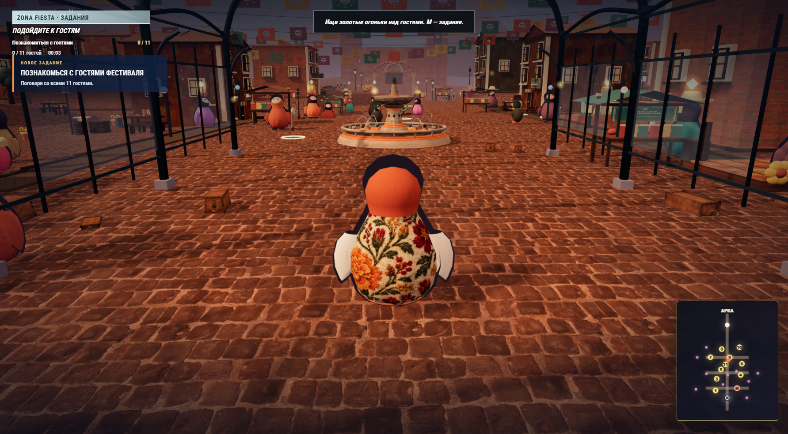
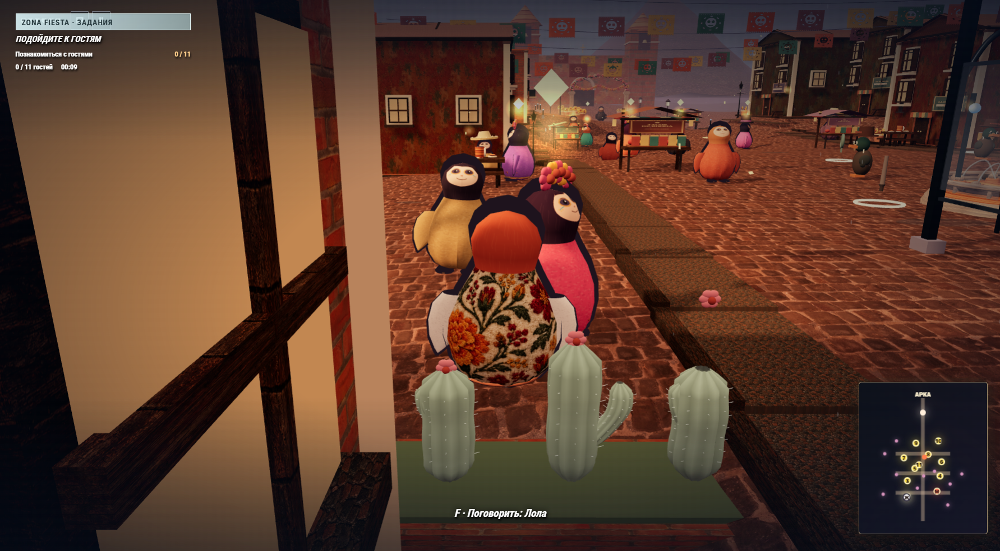

# Голубиные страсти, выпей Женя!

**Одиночное 3D-приключение на ночном фестивале в Мексике.** Женя знакомится с гостями, выполняет задания, исследует площадь и влияет на финал через диалоги и действия.

[⬇️ Скачать Windows-сборку](https://github.com/neonkitts/Golubinye-Strasti-Vypei-Zhenya/releases/tag/v2026.10.19)

## Что делает игрок

**Исследование → знакомство → задание → находка или столкновение → последствия для истории.** На площади можно разговаривать с гостями, открывать карту и инвентарь, находить предметы и вступать в драки. Диалоги с Филом, женихом Евгением и другими персонажами ведут к разным ситуациям и вариантам финала.

| Система | Игровая роль |
| --- | --- |
| Фестиваль и карта | Дают пространство для свободного исследования и ориентиры для заданий |
| Диалоги и квесты | Продвигают историю и ставят перед игроком выбор |
| Драки, подкат и выстрел | Меняют темп и создают риск в столкновениях |
| Физические ящики | Позволяют толкать, хватать, переносить и бросать объекты |
| Находки и инвентарь | Поддерживают подготовку к следующим событиям |

## Скачать и запустить

Доступна **только сборка для Windows 10/11 x64**. Скачайте ZIP из [релиза](https://github.com/neonkitts/Golubinye-Strasti-Vypei-Zhenya/releases/tag/v2026.10.19), распакуйте **всю папку** и запустите `Golubinye-Strasti-Vypei-Zhenya.exe`. Установка не требуется. Запуск одного EXE без соседних файлов невозможен.

## Управление

| Действие | Клавиши |
| --- | --- |
| Движение / камера | WASD / мышь |
| Бег / прыжок / подкат | Shift / пробел / Ctrl |
| Разговор или находка | F |
| Удары / атака / выстрел | Q и E / ЛКМ / R |
| Ящик: взять / бросить | G / T |
| Задание и карта / инвентарь | M / Tab |
| Пауза | Esc |

Поддерживается стандартный Xbox-геймпад. Настройки звука и эффектов доступны в меню паузы.

## Состояние и авторство

Это рабочая одиночная версия. Сетевой кооператив и контент полного масштаба Penguin Heist в ней не реализованы. Windows-сборка проверялась сценариями запуска, взаимодействия и физики; полный ручной проход здесь не заявлен.

Этот репозиторий содержит **только материалы проекта и Windows-релиз**: исходный код, браузерная и другие платформенные сборки не публикуются. Источники дополнительных материалов и лицензии перечислены в [ASSET_CREDITS.md](ASSET_CREDITS.md). Игра сделана как самостоятельный учебный проект; коммерческие ассеты, музыка и код Penguin Heist не включены.
